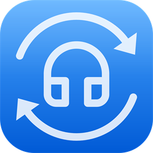
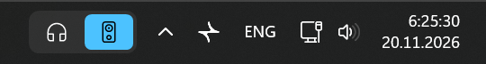
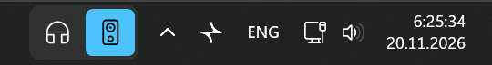
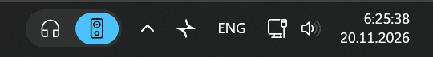
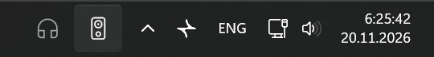
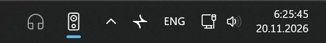
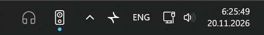
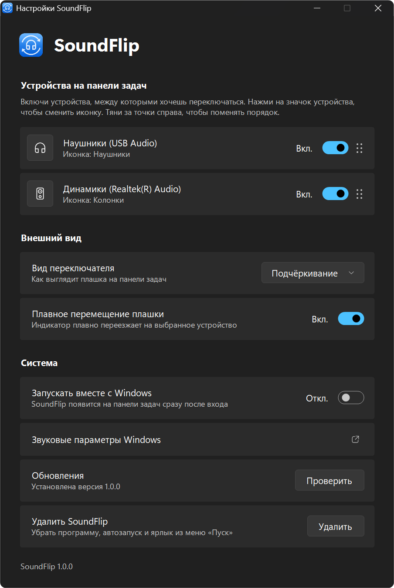

<div align="center">

<br>



<h1>SoundFlip</h1>

<p><b>Наушники ⇄ колонки — одним кликом прямо на панели задач Windows 11.</b></p>

<p>Маленький переключатель живёт рядом с треем<br>и выглядит так, будто его туда поставила сама Windows.</p>

<br>


<br>

[**Скачать**](../../releases/latest) &nbsp;·&nbsp; [Возможности](#-возможности) &nbsp;·&nbsp; [Как выглядит](#-как-это-выглядит) &nbsp;·&nbsp; [Установка](#-установка) &nbsp;·&nbsp; [Как устроено](#-как-это-устроено)

<br>

</div>

## ✨ Возможности

- 🎧 **Переключение в один клик.** Кнопки устройств встроены прямо в панель задач, слева от <kbd>^</kbd>. Плашка показывает, что играет сейчас, и плавно переезжает на выбранное устройство.
- 🎨 **Выглядит как родное.** Шесть стилей, микроанимации при наведении и нажатии как у системных кнопок, тёмная и светлая тема, ваш акцентный цвет Windows.
- 🔀 **Любые устройства.** Не только наушники и колонки: монитор, Bluetooth-гарнитура, USB-ЦАП. Порядок меняется перетаскиванием, иконка у каждого своя.
- 💬 **Подсказки.** Задержите курсор на кнопке, и над панелью появится название устройства, как у значков панели задач.
- 🔄 **Обновление в два клика.** Проверка и установка новой версии — прямо из настроек.

### 🖱️ Управление

- <kbd>Левый клик</kbd> по устройству — звук сразу переключается на него.
- <kbd>Правый клик</kbd> — меню: настройки, звуковые параметры Windows, выход.
- Повторный запуск SoundFlip (например, из «Пуска») открывает настройки.

---

## 👀 Как это выглядит

Настоящие скриншоты панели задач. Активное устройство — колонки.

### 1 · Пилюля
Компактная дорожка, внутри неё плашка цвета акцента. Плашка переезжает плавно (можно выключить).



### 2 · Пилюля (высота трея)
Та же пилюля, но в полную высоту кнопок трея.



### 3 · Капсула
Круглая дорожка с акцентным выделением.



### 4 · Подсветка как в трее
Без цветных заливок: активное устройство выделено той же мягкой подсветкой, что и значки трея.



### 5 · Подчёркивание
Полоска акцентного цвета под значком, как индикатор открытого приложения. Плавно переезжает (можно выключить).



### 6 · Точка
Самый минималистичный вариант: маленькая точка под активным устройством. Тоже переезжает плавно.



### ⚙️ Настройки
Окно в стиле приложения «Параметры» Windows 11: карточки, тумблеры и выпадающие списки как в системе.

<div align="center">
<br>

</div>

<br>

---

## 📦 Установка

1. Откройте [**Releases**](../../releases/latest) и скачайте `SoundFlip.exe`.
2. Запустите его. Больше ничего делать не нужно. Программа сама:
   - копирует себя в `%LOCALAPPDATA%\Programs\SoundFlip` (права администратора не нужны);
   - добавляет ярлык в меню «Пуск»;
   - включает автозапуск вместе с Windows (выключается в настройках);
   - находит подключённые устройства вывода и встаёт на панель задач.

> [!TIP]
> Windows SmartScreen может предупредить о неизвестном издателе: exe не подписан. Нажмите **«Подробнее» → «Выполнить в любом случае»**.

> [!NOTE]
> Ничего дополнительно ставить не нужно: .NET Framework 4 уже входит в Windows 10 и 11.

### 🔄 Обновление
**Настройки → Система → Обновления → «Проверить».** Если есть новая версия, кнопка превратится в **«Обновить»**: программа скачает релиз, заменит себя и перезапустится. Настройки сохраняются.

### 🗑️ Удаление
**Настройки → Система → «Удалить SoundFlip».** Удаляются программа, настройки, автозапуск, ярлык и всё, что Windows запомнила о программе в реестре. Следов не остаётся.

То же самое из командной строки:

```powershell
& "$env:LOCALAPPDATA\Programs\SoundFlip\SoundFlip.exe" --uninstall
```

---

## 🛠️ Сборка из исходников

Нужна только Windows: компилятор C# входит в .NET Framework, Visual Studio и SDK не нужны.

```powershell
powershell -ExecutionPolicy Bypass -File build.ps1
```

Результат — `dist\SoundFlip.exe`. Иконку `src\app.ico` (все размеры от 16 до 256 px) рисует `tools\make-icon.ps1`.

---

## 🔬 Как это устроено

<details>
<summary><b>Встраивание в панель задач</b></summary>

<br>

Переключатель — дочернее layered-окно `Shell_TrayWnd`. Оно рисуется через `UpdateLayeredWindow` с попиксельной прозрачностью и держится поверх XAML-содержимого панели. Позиция — слева от области уведомлений. Если проводник перезапустится, SoundFlip встроится заново. Если встроиться не получилось совсем, программа покажет обычный значок в трее.

</details>

<details>
<summary><b>Переключение звука</b></summary>

<br>

Список устройств — Windows Core Audio (`IMMDeviceEnumerator`). Устройство по умолчанию меняется через `IPolicyConfig`, тот же интерфейс использует панель звука Windows. Переключаются сразу все роли: обычная, мультимедиа и связь.

</details>

<details>
<summary><b>Анимации и внешний вид</b></summary>

<br>

Подсветка при наведении, нажатие, переезд плашки — экспоненциальное сглаживание с постоянными времени, подобранными под системные кнопки Windows 11. Размеры и прозрачности подсветки сняты с настоящей панели задач. Геометрия привязана к целым пикселям при любом масштабе, чтобы края оставались чёткими.

</details>
